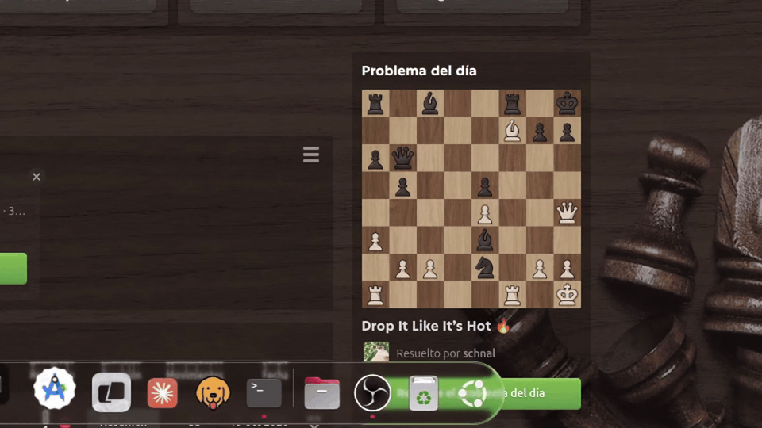
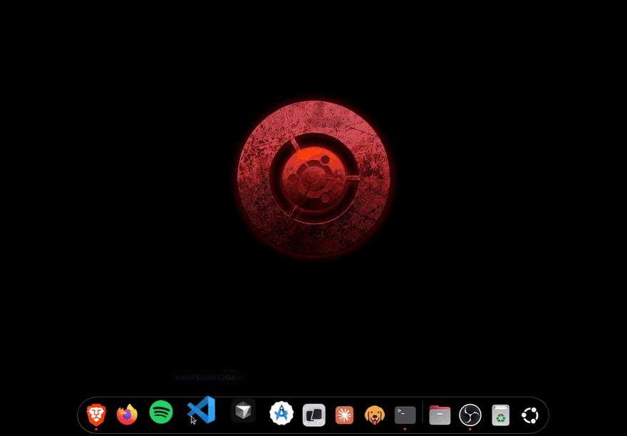
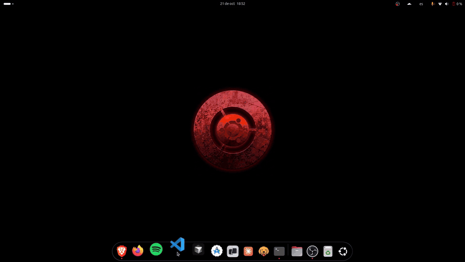

# Dock Glass

[English](README.md) · **Español**

[](https://github.com/atarico/dock-glass/actions/workflows/ci.yml)

Una extensión de GNOME Shell que hace que el dock de Ubuntu se sienta como el Dock de macOS: una píldora de vidrio, íconos que se agrandan de forma continua y se separan bajo el puntero, un rebote al abrir una aplicación, ventanas que se abren con un efecto genio desde su ícono y una pila de lugares al estilo macOS que sale del ícono de Archivos.

> [!NOTE]
> **Proyecto en etapa temprana.** Desarrollado y probado en Ubuntu 24.04, GNOME Shell 46 sobre X11, con Ubuntu Dock abajo, íconos de 48 px y el tema Yaru. Por ahora los valores son fijos; está prevista una ventana de preferencias. Todavía no está en [extensions.gnome.org](https://extensions.gnome.org).

## Así se ve



*La magnificación y la píldora de vidrio, sobre el Liquid Glass de Blur My Shell (grabación con zoom).*



*La pila de lugares de Archivos: las carpetas salen del ícono, vuelven a entrar en él al cerrarse y se abren con un clic.*



*Minimizar y restaurar con la extensión complementaria Magic Lamp. Dock Glass dirige su genio al lugar de reposo del ícono en el dock.*

## Funciones

| Función | Qué se ve |
|---------|-----------|
| Magnificación | Los íconos crecen desde su borde inferior a medida que el puntero se mueve sobre el dock: 1,4x bajo el puntero y de vuelta al tamaño normal tres íconos más allá. Como en macOS, ningún ícono se achica: los vecinos se separan y la píldora se ensancha para contenerlos |
| Píldora de vidrio | Un dock completamente redondeado con un borde interior claro, pensado para usarse sobre el Liquid Glass de Blur My Shell |
| Rebote al abrir | Un ícono rebota hasta que la aplicación que abrió muestra su ventana |
| Genio al abrir | Las ventanas nuevas salen de su ícono del dock, desde donde se dibuja aunque esté agrandado, en lugar de la animación de apertura de GNOME. macOS usa el genio solo para minimizar y restaurar; este es un agregado de Dock Glass |
| Pila de lugares de Archivos | Sin ventanas de Archivos abiertas, un clic en su ícono despliega en abanico los lugares (carpeta personal, Escritorio, Documentos, Descargas, Imágenes y marcadores). Los elementos salen del ícono y vuelven a entrar en él cuando la pila se cierra. Con ventanas de Archivos abiertas, el clic funciona como siempre |
| Archivos junto a la Papelera | Cuando Archivos es la última aplicación anclada, el separador pasa a su izquierda, así Archivos queda junto a la Papelera como las carpetas del Dock de macOS |
| Punto de ejecución | Un punto pequeño debajo de cada aplicación abierta |

Para tener también el genio al minimizar y restaurar, se puede agregar [Magic Lamp](https://github.com/hermes83/compiz-alike-magic-lamp-effect) (ver Configuración recomendada).

## Instalación

1. Clonar el repositorio en la carpeta de extensiones. El nombre de la carpeta tiene que ser el UUID de la extensión:
   ```sh
   git clone https://github.com/atarico/dock-glass.git \
     ~/.local/share/gnome-shell/extensions/dock-glass@local
   ```
2. Reiniciar GNOME Shell. En X11, presionar `Alt+F2`, escribir `r` y presionar Enter. En Wayland, cerrar sesión y volver a entrar.
3. Activarla:
   ```sh
   gnome-extensions enable dock-glass@local
   ```
4. Pasar el puntero sobre el dock: el ícono que está debajo crece por encima de la píldora y sus vecinos se separan.

Para actualizar, ejecutar `git pull` en esa carpeta y reiniciar GNOME Shell. Para desinstalar, ejecutar `gnome-extensions disable dock-glass@local` y borrar la carpeta.

## Configuración recomendada

Dock Glass da estilo y anima al dock de Ubuntu; el aspecto completo también depende de algunos ajustes fuera de la extensión.

**Ubuntu Dock.** Un fondo transparente (el vidrio lo pone Blur My Shell), un clic que enfoca o minimiza y un solo punto de ejecución:

```sh
gsettings set org.gnome.shell.extensions.dash-to-dock transparency-mode 'FIXED'
gsettings set org.gnome.shell.extensions.dash-to-dock background-opacity 0.0
gsettings set org.gnome.shell.extensions.dash-to-dock click-action 'focus-minimize-or-previews'
gsettings set org.gnome.shell.extensions.dash-to-dock running-indicator-style 'DEFAULT'
```

**Archivos.** Anclar Archivos como la última aplicación, para que quede junto a la Papelera.

**Blur My Shell** ([extensión](https://github.com/aunetx/blur-my-shell)). En sus preferencias, para el dock:

| Ajuste | Valor |
|--------|-------|
| Static blur (desenfoque estático) | Desactivado, para que el vidrio desenfoque lo que realmente está detrás del dock |
| Pipeline | Un solo efecto "Liquid Glass": blur radius 10, edge size 16, tint 0, shadow 0.1, specular strength 0.6 |

**Complementos opcionales.** [Magic Lamp](https://github.com/hermes83/compiz-alike-magic-lamp-effect) para el genio al minimizar y restaurar. [Burn My Windows](https://github.com/Schneegans/Burn-My-Windows) para los efectos de cierre; Dock Glass le deja el cierre de ventanas. Desactivar sus efectos de apertura, así las ventanas nuevas solo tienen el genio.

## Compatibilidad

| Componente | Estado |
|------------|--------|
| GNOME Shell 46 | Soportado |
| Otras versiones de GNOME Shell | Sin probar; `metadata.json` declara solo la 46 |
| Ubuntu Dock (`ubuntu-dock@ubuntu.com`) | Requerido |
| Dash to Dock de extensions.gnome.org | Todavía no soportado |
| Posición del dock | Solo abajo; los docks laterales quedan sin cambios |
| X11 | Probado |
| Wayland | Sin probar |

## Limitaciones conocidas

- **Valores fijos.** El tamaño máximo de la magnificación, su alcance y el vidrio son fijos hasta que exista la ventana de preferencias.
- **Textos de la pila en español.** La pila de lugares muestra "Abrir Archivos" y "Carpeta personal" en español, sea cual sea el idioma del sistema, hasta que la extensión tenga traducciones. Los nombres de las carpetas vienen del sistema.
- **Agrupación del separador.** Las aplicaciones abiertas que no están ancladas siguen apareciendo entre Archivos y la Papelera.
- **Activación con el teclado.** Abrir Archivos desde el teclado (Enter sobre un ícono con foco, o `Super`+número) sin ventanas de Archivos también abre la pila de lugares.
- **Partes internas de Ubuntu Dock.** La extensión se engancha a partes privadas de Ubuntu Dock, así que una actualización de Ubuntu Dock puede romperla. Todas se usan a través de `dockAdapter.js`, el único archivo a adaptar cuando eso pase.

<details>
<summary><strong>Cómo funciona</strong></summary>

- **Espacio superior.** Ubuntu Dock recorta su contenido. La hoja de estilos aumenta el relleno superior de los íconos y agrega el mismo margen superior al fondo de la píldora, así la píldora mantiene su tamaño y el ícono más grande puede sobresalir por encima. A los costados, la extensión desactiva el recorte de la vista con desplazamiento y ensancha el recorte del contenedor deslizante, que Ubuntu Dock restablece en cada asignación de tamaño, para que los íconos separados y el vidrio más ancho sigan visibles.
- **Magnificación.** Un `Clutter.Timeline` por dock lee el puntero en cada cuadro mientras está sobre la píldora. `magnifier.js` convierte la distancia de cada ícono al puntero suavizado en una escala (una caída coseno), y el ancho extra de los íconos intermedios en un desplazamiento lateral. La extensión los aplica solo como transformaciones: la escala en cada ícono, el desplazamiento en su botón (así el punto de ejecución lo sigue) y en el separador, y una escala y un desplazamiento horizontales en el fondo de la píldora, que el vidrio de Blur My Shell sigue. Las asignaciones de tamaño del dock nunca cambian, así que su región de entrada, el ocultamiento inteligente y los destinos al minimizar mantienen su geometría de reposo. El ciclo se detiene cuando los íconos se estabilizan, se reinicia con el movimiento del puntero y vuelve exactamente al diseño de reposo cuando el puntero se va.
- **Eventos.** Los eventos del puntero vienen de `dashtodockBox`, la caja reactiva del dock que sigue el paso del puntero. Clutter no pasa eventos a través del contenedor del dock, que no es reactivo.
- **Pilas.** Archivos recibe un reemplazo de `activate` en su instancia que abre la pila de lugares solo con un clic izquierdo simple y sin ventanas de Archivos. La pila es un actor transparente que cubre todo el escenario bajo `Main.pushModal`, y se cierra con un clic afuera, un clic en el ícono o Escape. El dock sigue visible mientras está abierta gracias al estado de menú de elementos de Ubuntu Dock. La opacidad se anima por separado del movimiento elástico, porque Clutter la guarda en 8 bits y un modo de animación que se pasa de largo la haría dar la vuelta.
- **Genio al abrir.** Un envoltorio de `Main.wm._shouldAnimateActor` omite la animación de apertura de GNOME para las ventanas normales de aplicaciones, y un manejador de `map` agrega en su lugar el efecto de deformación del genio. Parte del ícono del dock de la aplicación tal como se dibuja en ese momento, en el monitor de la ventana cuando la aplicación tiene un ícono ahí. El envoltorio se retira solo mientras sigue siendo el más externo, así convive sin problemas con Burn My Windows y Magic Lamp.
- **Separador.** Ubuntu Dock vuelve a insertar el separador después de las aplicaciones ancladas en cada redibujado. Cuando el ícono anterior es Archivos, la extensión lo mueve un lugar a la izquierda antes del siguiente cuadro. El separador no es un elemento de aplicación, así que la lista de aplicaciones del dock y el arrastrar y soltar no se ven afectados. Al desactivar la extensión, el movimiento se deshace.

</details>

## Desarrollo

| Archivo | Función |
|---------|---------|
| `extension.js` | Se engancha a Ubuntu Dock: magnificación, recortes, separador, pila de Archivos, rebote al abrir |
| `dockAdapter.js` | El único acceso a las partes privadas de Ubuntu Dock: cómo se carga, su administrador de docks y los actores de cada dock |
| `openAnimation.js` | Reemplaza la animación de apertura de ventanas por el genio |
| `genieEffect.js` | El efecto de deformación del genio |
| `magnifier.js` | Matemática pura de la magnificación |
| `stack.js` | La ventana emergente de la pila: actores, animaciones, entrada |
| `stackLayout.js` | Matemática pura de la disposición de la pila |
| `stylesheet.css` | Estilos de la píldora, el espacio superior, el punto de ejecución y la pila |
| `scripts/pack.sh` | Genera el zip instalable |
| `.github/workflows/ci.yml` | Pruebas, verificación de sintaxis y empaquetado en GitHub Actions, más versiones publicadas con etiquetas `v*` |

La matemática pura y el adaptador del dock no importan nada de GNOME, así que Node.js 22 o más nuevo puede probarlos desde la raíz del repositorio:

```sh
node --test
```

La misma ejecución también comprueba que los módulos de la raíz del repositorio solo se importen entre sí y que `metadata.json` esté completo. Para generar en `dist/` el archivo que acepta `gnome-extensions install`:

```sh
sh scripts/pack.sh
```

GitHub Actions ejecuta las pruebas, una verificación de sintaxis de cada módulo y el empaquetado en cada pull request y en cada push a `main`. Al subir una etiqueta `v*`, además publica una versión en GitHub con el zip empaquetado.

El lado de GNOME Shell no tiene pruebas automáticas. Para desarrollar, crear un enlace simbólico al clon en lugar de clonar dentro de la carpeta de extensiones:

```sh
ln -s "$PWD" ~/.local/share/gnome-shell/extensions/dock-glass@local
```

Reiniciar GNOME Shell después de cada cambio y ver los errores con:

```sh
journalctl -f -o cat /usr/bin/gnome-shell
```

## Licencia

[GPL-3.0 o posterior](LICENSE). Copyright (C) 2026 atarico.

`genieEffect.js` está adaptado del efecto de restauración de [Compiz alike magic lamp effect](https://github.com/hermes83/compiz-alike-magic-lamp-effect), de hermes83 (GPL-3.0 o posterior).
